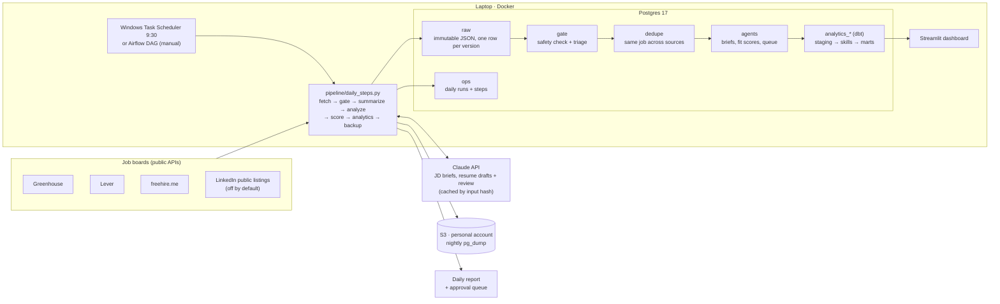

# de-job-hunt-agent

A data-engineering pipeline that ingests job postings daily, models skill demand with dbt, and feeds a team of Claude-powered agents that analyze each role, score fit, tailor a one-page resume, check it like an ATS, and report how well the candidate's skills cover the market.

**Status:** Milestones 1–4 done (ingestion, agents, dbt + dashboard, orchestration + backup); Milestone 5 switches from the fictional sample profile to the real one. Details: [`docs/STATUS.md`](docs/STATUS.md).

## Architecture



**One day's run.** Fetch every board and saved search (the sources in parallel under Airflow), store each posting's raw JSON once per content change, run every new posting through a safety gate (job postings are untrusted input: hidden text and instruction-like lines are flagged before any model reads them), work out which jobs are new today across sources, have Claude brief the new in-scope ones, score fit in code, rebuild the dbt models, back up to S3, and write a report with the jobs worth applying to.

## Design principles

- **Code decides at runtime; AI only proposes.** Fit scores, triage and resume fact checks are deterministic code plus versioned rules files, checked against a golden set of labeled cases. The model writes briefs and drafts; code checks every claim against the candidate's evidence before anything reaches a PDF. LLM calls are cached by (input hash, prompt version, model), so a rerun doesn't drift or cost again.
- **Raw is immutable, loads are idempotent.** Running a day twice adds nothing the second time. "New today" is defined by the run's own ingest ids, not by clocks.
- **One copy of the logic.** Each daily step is a plain function that saves its result in `ops.daily_run_steps`. The Windows task runs them in one process; the Airflow DAG runs one per task, so a failed step can be retried alone.
- **A human approves every application.** The repo builds an approval queue; nothing is submitted on its own.
- **Private data stays private.** The real resume and evidence live in a gitignored folder and reach the database only at run time; everything public is built and tested against a fictional sample profile.

## Numbers (2026-11-10)

- ~18,800 distinct postings from 20 sources, ~19,800 stored versions
- 223 postings briefed by Claude for about $8 in total (cap: 50 a day)
- 56 dbt steps (models, seed, data tests); 658 automated tests
- Daily backup ~84 MB to S3, with a monthly restore into a scratch database to prove it works

## Run it

Everything runs on Windows with [uv](https://docs.astral.sh/uv/) and Docker Desktop. Copy `.env.example` to `.env` and fill it in first.

```bash
docker compose up -d                               # Postgres
uv run python -m pipeline.daily                    # one day's run, report in output/daily/
uv run pytest                                      # tests (database tests skip when Postgres is down)
uv run streamlit run dashboard/app.py              # dashboard on 127.0.0.1:8501
docker compose --profile airflow up -d --build     # Airflow on 127.0.0.1:8080 (optional)
```

## Repo layout

| Folder | What's in it |
| --- | --- |
| `ingestion/` | One fetcher per source (Greenhouse, Lever, freehire, LinkedIn public) |
| `pipeline/` | Load, safety gate, triage, dedupe, the daily steps, analytics, backup |
| `agents/` | JD analysis, fit scoring, resume tailoring and review, PDF and ATS checks, approval queue |
| `.claude/skills/` | The rules each agent follows, one `SKILL.md` per agent, versioned |
| `config/` | Boards, searches, triage rules, scoring rules, skill vocabulary |
| `dbt/` | Staging → skills → marts, with data tests |
| `dags/` | The Airflow DAG |
| `dashboard/` | Streamlit app reading the marts |
| `docker/`, `docker-compose.yml` | Postgres, and Airflow with the pipeline's own Python environment |
| `templates/` | The one-page Typst resume with bundled fonts |
| `data/sample/` | The fictional candidate everything is tested against |
| `tests/` | pytest, with golden sets in `tests/fixtures/` |

## Docs

- [`docs/DESIGN.md`](docs/DESIGN.md): architecture and agents
- [`docs/DECISIONS.md`](docs/DECISIONS.md): every design decision and why
- [`docs/INTERVIEW_NOTES.md`](docs/INTERVIEW_NOTES.md): how to explain each milestone
- [`docs/AWS_SETUP.md`](docs/AWS_SETUP.md): the backup bucket and its least-privilege key

## Credits

The agent layer adapts ideas from the MIT-licensed [ai-job-search](https://github.com/ai-job-search-dev/ai-job-search) framework (JD safety gate, drafter-reviewer loop, PDF compile-and-inspect, ATS text-layer check, LinkedIn and freehire search tools).

The resume template bundles [Liberation Sans](https://github.com/liberationfonts/liberation-fonts) 2.1.5 under the SIL Open Font License (`templates/fonts/LICENSE`).
